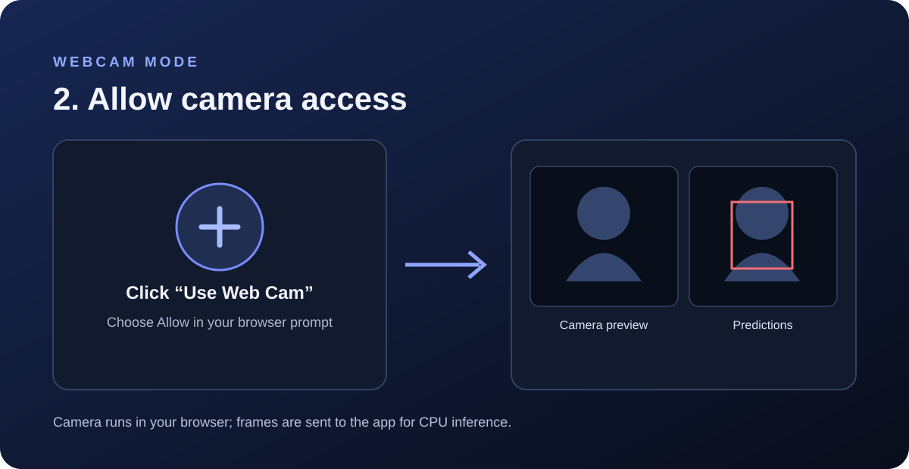
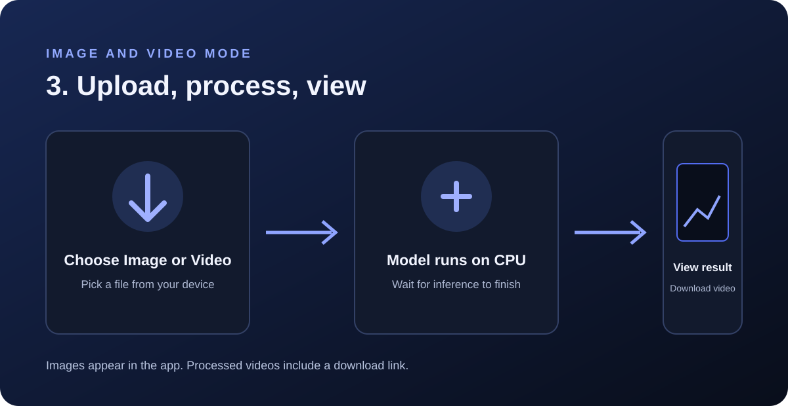

# YOLO Vision Studio

A Flask app for trying four trained Ultralytics YOLO models on images, live webcam frames, and videos. All inference runs on CPU.

**Designed & created by Murtaza Ali**

- Website: [murtazaalikhan.com](https://www.murtazaalikhan.com)
- Kaggle: [murtazakhanpro](https://www.kaggle.com/murtazakhanpro)

## How to use

Choose a model from the dropdown, then select a webcam, video, or image workflow.


| Model | Weight file |
| --- | --- |
| Object Detection | `object_detection.pt` |
| Segmentation | `segmentaion_model.pt` |
| Pose Estimation | `pose_model.pt` |
| OBB (Oriented Bounding Boxes) | `obb.pt` |

The segmentation weight filename keeps the spelling of the supplied file. If you rename it, also change `MODEL_FILES` in `app.py`.

### Webcam

Click **Use Web Cam** and allow camera access in the browser. The left panel shows your camera preview and the right panel shows predictions. Click the button again to stop. Camera access requires a secure browser context, such as the HTTPS Hugging Face Space URL.



### Image

Click **Upload Image**, choose an image, and wait for the annotated result.

### Video

Click **Upload Video**, choose a video, and wait for inference to finish. Then use **Download processed video**.



Uploads are limited to 500 MB. Supported images: JPG, JPEG, PNG, BMP, WEBP, TIF, TIFF. Supported videos: MP4, AVI, MOV, MKV, WEBM, MPEG, MPG.

## Deploy to Hugging Face Spaces

The target Space is [Murtazakhanpro/Vision_Studio](https://huggingface.co/spaces/Murtazakhanpro/Vision_Studio). Choose the **Docker** SDK and upload the contents of this `Assignment_14` folder to the Space repository root. Keep `README.md`, `Dockerfile`, `app.py`, both requirements files, all four `.pt` files, and `docs/images/` in the repository. The README YAML selects Docker and port 7860.

The four weights total about 167 MiB. Use Git LFS (the included `.gitattributes` tracks `.pt` files) or Hugging Face's web uploader for the weights. Wait for the Docker build and model loading to finish before opening the Space.

## Run locally

Use Python 3.11, then from this directory:

```bash
python -m pip install -r requirements-cpu.txt
python app.py
```

Open [http://localhost:7860](http://localhost:7860). To use the production Gunicorn server locally, run:

```bash
gunicorn --bind 0.0.0.0:7860 --workers 1 --threads 4 --timeout 0 app:app
```

The CPU build processes video more slowly than a GPU, and webcam frame rate depends on the available CPU. Uploads and processed videos use temporary container storage and may be cleared when the Space restarts.

## Files

- `app.py` — Flask interface, browser webcam, and inference endpoints.
- `Dockerfile` — Hugging Face Docker Space image and Gunicorn startup.
- `requirements.txt` — application dependencies and CPU PyTorch wheel index.
- `requirements-cpu.txt` — local/Docker requirements entry point.
- `object_detection.pt`, `segmentaion_model.pt`, `pose_model.pt`, `obb.pt` — trained weights.
- `docs/images/` — visual quick-start guides.

## License and model provenance

Set a Space license only after confirming redistribution terms for the app and all four model weight files. This project does not assert that the supplied weights are licensed for redistribution.
